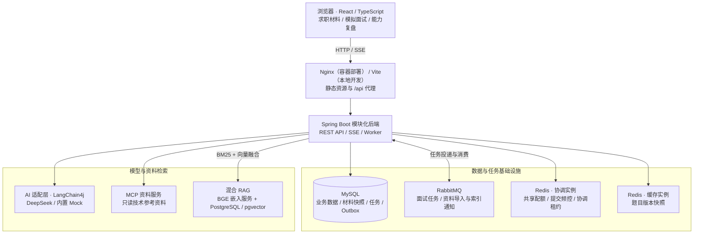
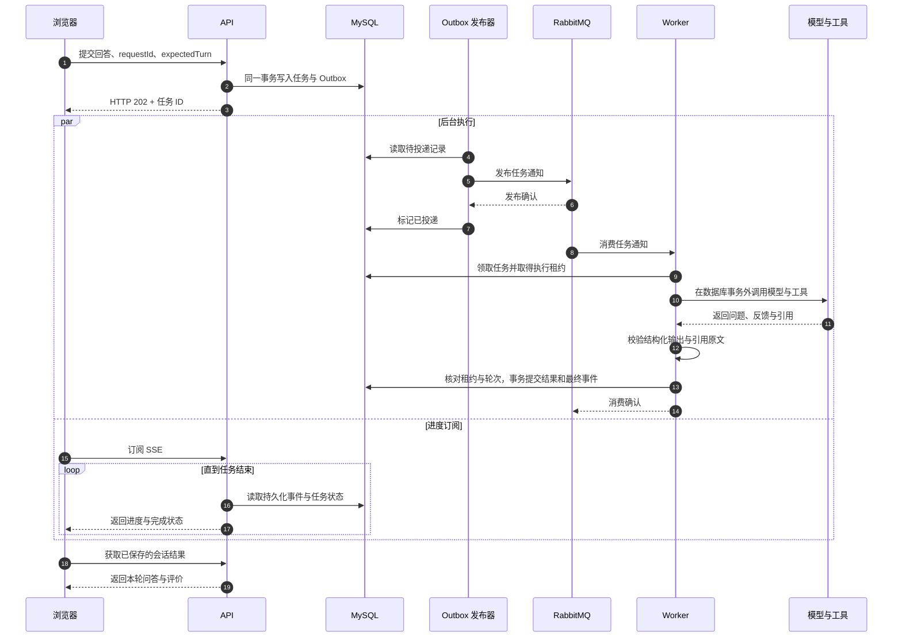

# 职智达 · AI 模拟面试平台

围绕目标岗位和项目经历，完成多轮面试、回答复盘与针对性复练。

职智达是一款围绕目标岗位、简历和个人知识资料开展训练的 AI 模拟面试平台，当前重点覆盖 Java 后端面试场景，同时支持通过自定义岗位与材料开展其他方向的面试练习。练习结束后，可以从评价定位回答原文，结合相关资料查漏补缺，再把需要加强的能力加入下一次训练。

[功能特性](#功能特性) · [项目架构](#项目架构) · [快速开始](#快速开始) · [技术栈](#技术栈) · [本地开发](#本地开发) · [项目结构](#项目结构) · [文档](#文档)

## 功能特性

| 模块         | 功能                                                                     |
| ------------ | ------------------------------------------------------------------------ |
| 岗位与简历   | 提取 JD 要求、关联简历证据，支持文档导入、AI 优化、版本比较与恢复        |
| 模拟面试     | 岗位面试、项目深挖和专项训练，可选择教学练习或正式模拟，并设置难度与轮数 |
| 能力复盘     | 定位回答原文与引用依据，查看能力观察，发起复练并对照前后表现             |
| 题库与知识库 | 题目筛选与组练、个人笔记导入、带引用的资料问答和自测题生成               |
| 训练计划     | 将能力点和题目加入计划，管理练习任务，跟踪跨场次训练记录                 |

## 项目架构

项目采用前后端分离架构：React 负责交互，Spring Boot 后端按业务划分模块，MySQL 保存业务数据与任务状态。API 受理请求，Worker 执行面试、资料导入等后台任务；两者默认在同一进程运行，也可使用同一后端镜像分进程部署。

### 整体架构



MySQL 保存任务检查点与跨会话学习记忆，RabbitMQ 负责 Worker 调度与延迟重试。两个 Redis 实例分别承担协调与缓存。标准 Docker 部署使用 BM25 与 BGE 向量融合检索；MCP 提供技术参考资料。开启个人历史使用偏好后，Agent 可以检索历史能力观察及原始证据。

### 后端模块

后端以 `cn.edu.whu.zhizhida` 为根包，业务模块通过各自的 `api` 契约协作。ArchUnit 与 SQL 边界测试约束跨模块访问。

| 模块                                 | 主要职责                                             |
| ------------------------------------ | ---------------------------------------------------- |
| `auth` / `application`               | 账号认证、演示空间，以及账号生命周期中的跨模块流程   |
| `jobs` / `resume`                    | 目标岗位与 JD 提取、简历导入与优化、版本管理         |
| `interview`                          | 面试会话、能力规划、追问策略、异步命令与 Worker 执行 |
| `evaluation` / `learning`            | 回答评价与引文核验、跨场能力观察、学习目标和训练计划 |
| `questionbank` / `knowledge`         | 题目版本与组练、资料导入与索引、知识问答和资料自测   |
| `ai`                                 | 模型协议适配、工具调用接口、MCP 与向量服务接入       |
| `quota` / `observability` / `health` | 用量配额、运行指标与链路追踪、健康检查               |

### 一次面试回答的处理流程



相同 `requestId` 的相同命令可安全重试，Worker 提交前再次校验租约和预期轮次。任务受理后即可订阅进度，SSE 断线后按事件序号续读，持续连接失败时退回状态查询。

### 关键设计

- **任务可靠性**：任务与 Outbox 同事务写入；消息重复投递时检查任务终态和租约，避免重复提交同一轮结果。
- **材料与评价可追溯**：开场固定岗位、简历和资料版本；回答与资料引文核对原文及位置，复盘可定位到本场使用的材料。
- **模型执行受控**：取证与最终生成分阶段执行，应用管理工具权限、调用预算和检查点；确定性路由由服务端填写，模型按引文生成评价，经校验后提交。
- **前端状态恢复**：保留待提交回答和简历草稿，处理版本冲突与账号切换，支持中断后继续练习。

### 部署方式

| 方式         | 组成与用途                                                                     | 配置入口                                                  |
| ------------ | ------------------------------------------------------------------------------ | --------------------------------------------------------- |
| 标准部署     | 一个后端进程运行 API 与 Worker，配合前端和中间件完成完整流程                   | [docker-compose.yml](docker-compose.yml)                  |
| 分进程部署   | API 受理请求与发布任务，Worker 消费任务；共享数据库、协调 Redis 和资料导入目录 | 叠加 [docker-compose.split.yml](docker-compose.split.yml) |
| 混合 RAG | 标准部署内置 BGE 与 pgvector；源码运行使用项目内启动脚本                                | [RAG 配置说明](docs/启动与故障排查.md#混合检索)           |

更详细的事务边界、检索规则与源码入口见[架构文档](docs/architecture.md)，部署步骤见[启动与故障排查](docs/启动与故障排查.md)。

## 快速开始

安装 Docker 与 Docker Compose，在项目根目录执行：

```sh
docker compose --profile app up -d --build
```

打开 [http://localhost](http://localhost/)，点击 **进入独立演示空间**。每次进入都会创建一份独立的演示数据，可直接使用预置岗位、简历和笔记。

推荐体验路径：选择演示岗位与简历 → 开始 3 轮面试 → 查看能力复盘 → 发起复练或加入训练计划。

默认使用内置 Mock 模型，无需 API Key。接入 DeepSeek 时，在根目录 `.env` 中设置 `AI_PROVIDER=deepseek`、`DEEPSEEK_API_KEY` 和账号可用的 `DEEPSEEK_MODEL`，再执行启动命令。

查看服务状态可运行 `docker compose --profile app ps`。更多配置见 [.env.example](.env.example) 和[启动与故障排查](docs/启动与故障排查.md)。

### 服务端口

下表为默认配置。Docker 列表示“宿主机 → 容器”；源码启动使用本机端口连接中间件。

| 服务            | Docker 端口映射            | 本机开发端口 | 用途                                |
| --------------- | -------------------------- | ------------ | ----------------------------------- |
| 前端            | 80 → 80                    | 5173         | 页面入口，代理 /api 请求            |
| 后端            | 8080 → 8080                | 8080         | REST API、SSE，接口文档 /doc.html   |
| MySQL           | 3307 → 3306                | 3307         | 业务数据与任务状态                  |
| Redis 协调实例  | 6379 → 6379                | 6379         | 共享配额、租约与提交频控            |
| Redis 缓存实例  | 6380 → 6379                | 6380         | 题目快照缓存                        |
| RabbitMQ        | 5672 → 5672                | 5672         | 异步任务通知                        |
| RabbitMQ 管理页 | 15672 → 15672              | 15672        | [队列管理](http://127.0.0.1:15672/) |
| MCP 资料服务    | 容器内 18091，不映射宿主机 | 18091        | 只读技术资料检索                    |

端口可在 [.env.example](.env.example) 对应配置项中调整；`FRONTEND_PORT` 用于 Docker，`DEV_FRONTEND_PORT` 用于本机 Vite。Docker 默认前端监听所有网卡，其他已映射端口监听本机回环地址。

Docker 内置的 BGE 与 pgvector 仅在容器网络提供服务。源码运行通过 `node scripts/enable-rag.mjs` 配置 **18092** 嵌入服务与 **15432 → 5432** 向量库。[RAG 与分进程部署说明](docs/启动与故障排查.md)

## 技术栈

| 层次       | 技术                                                                             |
| ---------- | -------------------------------------------------------------------------------- |
| 前端       | React 18、TypeScript、Ant Design、Zustand、Vite                                  |
| 后端       | Java 21、Spring Boot 4、Spring Security、MyBatis-Plus                            |
| 数据与消息 | MySQL 8.4、Flyway、Redis、RabbitMQ                                               |
| 模型与检索 | LangChain4j、DeepSeek、MCP、本地 BGE、pgvector                                   |
| 文档处理   | Apache PDFBox、Apache POI                                                        |
| 观测与测试 | Actuator、Micrometer、OpenTelemetry、JUnit、ArchUnit、Playwright、GitHub Actions |

## 本地开发

准备 JDK 21、Maven、Node.js 22.14+ 和 Docker Compose，在项目根目录运行：

```sh
node scripts/dev.mjs --mock-ai
```

Windows 也可运行 `.\start.cmd --mock-ai`。启动器准备依赖服务、编译后端并启动 Vite，就绪后访问 [http://127.0.0.1:5173](http://127.0.0.1:5173/)。前端使用 pnpm 9.15.9 管理依赖。

### 常用检查

| 检查               | 工作目录    | 命令                                       |
| ------------------ | ----------- | ------------------------------------------ |
| 前端检查与构建     | `frontend/` | `pnpm lint`、`pnpm test`、`pnpm build`     |
| 后端单元与架构测试 | `backend/`  | `mvn test`                                 |
| 接口契约           | 项目根目录  | `node scripts/api-contract.mjs check`      |
| 浏览器核心流程     | `frontend/` | 完成构建和浏览器安装后执行 `pnpm test:e2e` |

[GitHub Actions](.github/workflows/verify.yml) 配置了单元测试、MySQL 集成测试、覆盖率检查、接口契约、容器构建和浏览器验收。完整命令、浏览器前置条件及模型评测记录见[开发与验证](docs/开发与验证.md)和[测试与评测记录](docs/evidence/README.md)。

已完成真实模型单轮生命周期与引用专项复核、6 项 RabbitMQ 派发与故障回放、前端与 MCP 的 11 项容器检查；后端、BGE、前端及 MCP 镜像均完成构建。面试相关回归测试 276 项通过。各项样本、模型用量与验证范围见[运行验收](docs/evidence/runtime-acceptance.md)。

### 接口说明

业务接口使用 Bearer Token 认证。面试开场与回答返回 HTTP 202 和任务 ID，客户端通过任务查询或 SSE 跟踪进度，再读取会话结果。

[OpenAPI 定义](contracts/openapi.json) · [完整调用示例](docs/开发与验证.md#接口调用示例)

## 项目结构

```text
.
├── frontend/                 # React 页面、状态管理与浏览器验收
├── backend/                  # Spring Boot 业务模块、数据库迁移与测试
├── services/
│   ├── mcp-reference/        # 只读技术资料服务
│   └── embedding/            # 本地向量嵌入服务
├── contracts/                # OpenAPI 与评测契约
├── scripts/                  # 启动、验证与打包脚本
├── docs/                     # 使用指南、架构与评测记录
├── .github/workflows/        # CI 工作流
├── docker-compose.yml        # 标准部署
├── docker-compose.split.yml  # API / Worker 拆分部署
├── .env.example              # 环境配置示例
└── LICENSE                   # MIT 许可证
```

## 文档

| 文档                                      | 内容                                 |
| ----------------------------------------- | ------------------------------------ |
| [使用指南](docs/使用指南.md)              | 材料准备、面试、复盘、题库和训练计划 |
| [启动与故障排查](docs/启动与故障排查.md)  | Docker、源码启动、模型接入和运行配置 |
| [架构与代码入口](docs/architecture.md)    | 任务事务、模块职责、检索与中间件协作 |
| [开发与验证](docs/开发与验证.md)          | 接口示例、提示词维护、测试与源码打包 |
| [测试与评测记录](docs/evidence/README.md) | 评测方法、运行结果和原始证据         |
| [Agent 与中间件运行验收](docs/evidence/runtime-acceptance.md) | 模型、引用、RAG、消息故障与容器的专项结果 |

## 许可证

[MIT License](LICENSE)
